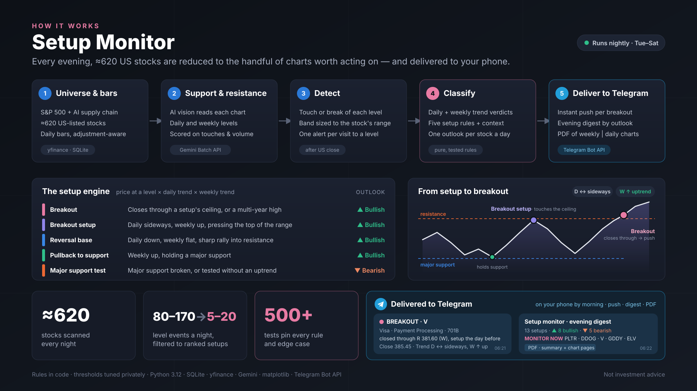

# Setup Monitor — S&P 500 + AI chain

A nightly chart monitor for about 620 US stocks: the S&P 500 plus a
hand-built universe of AI supply-chain names. Every evening after the US close
it tests each stock's support and resistance levels against the day's bar,
decides which of a small set of trading **setups** the event belongs to, and
delivers the result to Telegram: a push per stock to act on, a grouped digest,
and a PDF report with a weekly and a daily chart for every alerted stock.

The point is to replace "scroll 600 charts" with "read ten lines": only
events that match a defined setup reach you, ranked by how actionable they are.



---

## What it alerts on

Each level event is classified by what price did at the level and by the
**daily** and **weekly** trend verdicts at that moment. The rules are in the
code; the thresholds behind them are tuned values kept in a private
`params.toml` (see [Parameters](#parameters)).

| Setup | Outlook | Condition |
|---|---|---|
| 🚀 **Breakout** | Bullish | Price **closes through** the resistance of a recent Breakout setup on the same stock, **or** closes above its multi-year weekly high (any trend). The buy-in signal. |
| 🟣 **Breakout setup** | Bullish | Daily **sideways**, weekly **up**, price touches or breaks the **top** of the daily range (no higher daily resistance touched inside the daily trend window). A base pressing on its ceiling — monitor immediately. |
| 🔵 **Reversal base** | Bullish | Daily **down**, weekly **sideways**, price at resistance after a sharp rally off its recent low. Sub-tagged *double bottom* (the resistance is a live double bottom's neckline) or *breakout retest* (price recently closed above it and fell back). |
| 🟢 **Pullback to support** | Bullish | Weekly **up**, and price holds a **major** support with the daily trend up or sideways — or, daily sideways, sits below a higher resistance it already reached (mid-range on the way back down). |
| 🟠 **Major support test** | Bearish | Any other hit of a **major** support: a break, or a touch without a weekly uptrend. |

Each stock gets **one outlook per day**. When one bar produces both a bullish
and a bearish setup (e.g. it breaks one support and holds the next), the weekly
trend decides: up → Bullish, down → Bearish, sideways → listed as **Sideways**
(a range, both levels shown), undecided → not shown. The overruled level is
kept as a note on the alert.

User-named **price watches** (`watches.py`) are always delivered.

### How the pieces are measured

- **Levels** — support and resistance for each stock on the daily and weekly
  charts, proposed by Gemini from a chart image (Batch API) and then scored
  from the price data (`sr_major.py`): touches, reactions, band volume and
  span decide which levels are *major*. Daily levels refresh weekly, weekly
  levels monthly.
- **Touch / break** (`touch_detect.py`) — side-aware against a band sized to
  the stock's own volatility (a fraction of its median daily bar). A break
  needs a *close* through the level with the previous close on the other side;
  a repeated touch during one visit to a level alerts once.
- **Trend** (`trend.py`) — a log-price line fit, scored as
  `drift = slope·√n / median bar range`, which makes one threshold mean the
  same thing for every stock and window length. A small |drift| is sideways; a
  poor fit (low R²) is undecided. The window starts short and widens month by
  month only while the verdict is undecided.
- **Volume** — every alert line on a chart page shows the day's volume and its
  multiple of the 20-day median.

---

## What you receive

1. **Pushes** — one per stock with a Breakout or Breakout setup (capped at
   five a night), Breakouts first, listing every level it fired at, the close
   and both trends.
2. **Digest** — session header and counts, *MONITOR NOW*, clusters of names
   from one sub-industry moving together, then every stock grouped by outlook
   → main category → subcategory (AI-chain layers and tech first), two lines
   each.
3. **PDF report** (A4 landscape) — a summary page (setup tiles, MONITOR NOW,
   Bullish and Bearish tables), then per stock a page with the **weekly
   (3 years) and daily (12 months) charts side by side**: levels, the alerted
   level, the alert bar, and each panel's trend verdict with its drift, fit
   and window.

A night's delivery in Telegram (session of 2026-10-09):

<video src="screen_records/record_20261009.mp4" controls width="360"></video>


https://github.com/user-attachments/assets/c6b3a42f-cb1d-473f-93bd-d9448a514638


---

## Pipeline

```
refresh_universe.py   monthly   S&P 500 constituents (Wikipedia) + AI-chain tickers
update_bars.py        nightly   incremental daily bars (yfinance), adjustment-drift resync
refresh_levels.py     weekly /  submit batch jobs for daily / weekly S&R levels
collect_levels.py     monthly   collect finished batches, score and store levels
check_alerts.py       nightly   detect, classify, build the PDF, deliver to Telegram
```

All state lives in one SQLite database (`state/monitor.db`): bars, universe,
levels, visits, alerts and watches.

---

## Setup

Requires Python 3.12.

```bash
pip install -r requirements.txt
```

Create a `.env` in the project root (it is git-ignored) — see `.env.example`:

```bash
GEMINI_API_KEY=...          # level detection
TELEGRAM_BOT_TOKEN=...      # delivery
TELEGRAM_CHAT_ID=...
```

### Parameters

The rules read their thresholds — trend band and fit floor, trend windows,
touch-band size, major-level floors, breakout and reversal-base windows,
shock and confluence settings — from `params.toml` through `params.py`.

```bash
cp params.example.toml params.toml   # then set your own values
```

`params.toml` is git-ignored. **The values in `params.example.toml` are
illustrative, not the monitor's tuned ones**; without a `params.toml` the
project still runs on them and says so on start-up. `SETUP_MONITOR_PARAMS`
points at a different file.

First run:

```bash
set -a; . ./.env; set +a
python refresh_universe.py                       # constituents
python add_chain_universe.py                     # AI-chain tickers
python update_bars.py                            # full history, first time
python refresh_levels.py --timeframe daily --submit
python refresh_levels.py --timeframe weekly --submit
python collect_levels.py                         # once the batches finish
python check_alerts.py --bootstrap               # record the current state, send nothing
```

`--bootstrap` matters: the first check finds every level already touched, which
is the state of the index rather than news. It records those visits and marks
them delivered so the next run alerts only on changes.

### Schedule

`scripts/crontab.txt` holds the production schedule (server in UTC+8, so the
nightly jobs run Tue–Sat mornings after each US session):

| When | Job |
|---|---|
| Tue–Sat 06:00 | `update_bars.py` |
| Tue–Sat 06:20 | `check_alerts.py` |
| Saturday | daily level refresh and collection |
| First Saturday of the month | universe refresh, weekly level refresh |

Replace `/path/to/double_bottom` and the Python path in it for your machine
before installing.

---

## Everyday commands

```bash
python check_alerts.py --dry-run                 # detect and build the PDF, send nothing

python watches.py add ICE 124 CME 220 --title "Double bottom watch"
python watches.py list

python scripts/preview_setups.py --day 2026-10-09 --charts         # rebuild a past session, read-only
python scripts/preview_setups.py --day 2026-10-09 --charts --send  # ...and send it to Telegram
python scripts/replay_setups.py --days 15        # setup counts per night under the current rules
```

---

## Layout

| Path | What |
|---|---|
| `check_alerts.py` | Nightly detection, setup tagging, confirmation, delivery |
| `setups.py` | The setup rules — pure functions |
| `params.py`, `params.example.toml` | Loader for the tuned thresholds; illustrative values |
| `setup_context.py` | Price context the rules need: higher resistance touched, rally, retest, double-bottom neckline, long-range high, volume |
| `trend.py` | Daily / weekly trend verdicts |
| `touch_detect.py` | Touch, break and shock rules |
| `sr_major.py`, `levels.py`, `level_batch.py` | Level detection, scoring and the Gemini batch flow |
| `sr_prompts_example.py` | A generic level-detection prompt; the tuned one (`sr_prompts.py`) is private |
| `double_bottom_sr.py` | Level-anchored double-bottom detector |
| `alert_grouping.py`, `ai_chain.py` | Outlook → category → subcategory grouping; the AI-chain tiers |
| `report_pdf.py`, `alert_chart.py`, `report_style.py` | PDF report, chart pages, shared colours |
| `notify_telegram.py` | Telegram formatting and delivery |
| `store.py`, `bars.py`, `update_bars.py`, `universe.py` | SQLite store, bar handling, data refresh |
| `scripts/` | Preview, replay, crontab and one-off maintenance |

The calibration research, design documents and test suite (over 500 tests —
the rules are pure functions over hand-written bars, so every setup and edge
case is pinned) are kept private, because they encode the tuned values.

---

## Notes

- Not investment advice. The monitor reports what price did against defined
  rules; it makes no prediction.
- Market data comes from Yahoo Finance via `yfinance` and is subject to its
  terms and availability.
